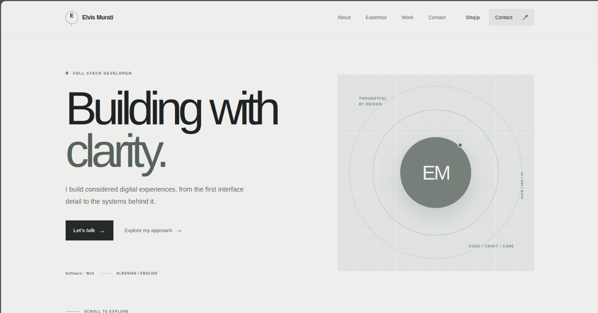

# Elvis Murati — Portfolio

Portofoli personal i Elvis Muratit, i krijuar për të prezantuar punën, aftësitë dhe mënyrën time të qasjes në zhvillimin e përvojave digjitale.

## Faqja online

🔗 **[Vizito portofolin](https://elvismurati-creator-bumwvjo2a-v1ct0r7.vercel.app/)**

Faqja është e disponueshme në **anglisht** dhe **shqip**.

## Pamje nga projekti



## Rreth projektit

Portofoli është një faqe personale, responsive dhe dygjuhëshe, që prezanton:

- Prezantimin dhe qasjen time profesionale
- Ekspertizën dhe punën time
- Mënyrat për të më kontaktuar
- Përmbajtje në anglisht dhe shqip

## Teknologjitë

- [Next.js](https://nextjs.org/) 16
- [React](https://react.dev/) 19
- [TypeScript](https://www.typescriptlang.org/)

## Nisja në kompjuterin tënd

Nevojitet [Node.js](https://nodejs.org/) dhe npm.

```bash
git clone https://github.com/v1ct0R7/Nextjs_web_Personal.git
cd Nextjs_web_Personal
npm install
npm run dev
```

Hape [http://localhost:3000](http://localhost:3000) në shfletues.

## Konfigurimi i formularit të kontaktit

Për dërgimin e mesazheve nga formulari nevojitet një llogari [Resend](https://resend.com/) dhe një adresë dërguese e verifikuar. Krijo `.env.local` në direktorinë kryesore dhe vendos:

```env
RESEND_API_KEY=vendos_celesin_tend
RESEND_FROM_EMAIL=adresa_e_verifikuar
SITE_URL=https://elvismurati-creator-bumwvjo2a-v1ct0r7.vercel.app
```

Mbaji këto vlera private dhe mos i publiko në GitHub. Për Vercel, shtoji te **Project Settings → Environment Variables** dhe bëj redeploy që ndryshimet të hyjnë në fuqi. Pa konfigurimin e Resend, formulari nuk mund të dërgojë email.

## Kontrolli i projektit

```bash
npm run lint
npx tsc --noEmit
npm run build
```

---

Krijuar nga **Elvis Murati**.
